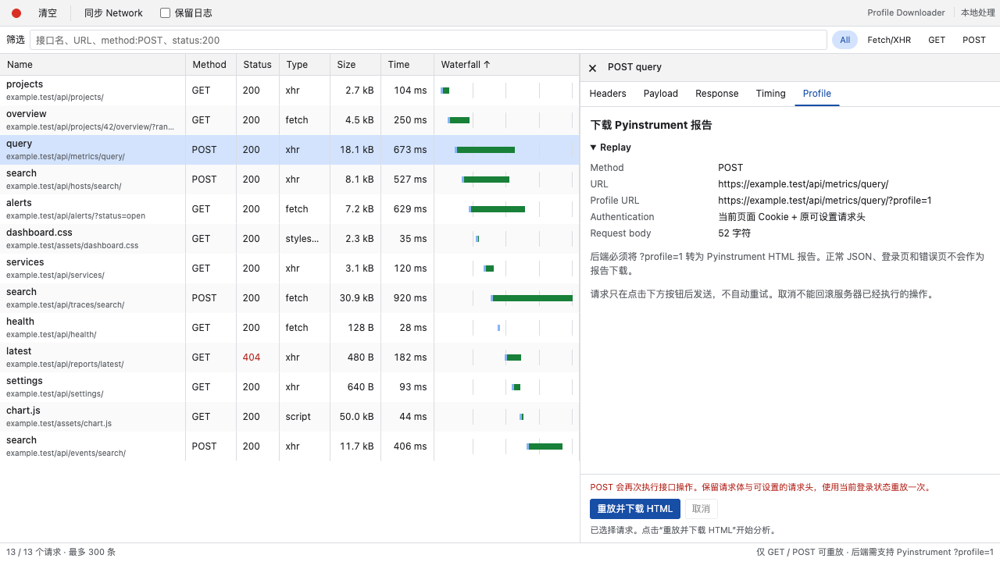

# Profile Downloader

A small Chrome / Edge DevTools extension to replay a captured **GET or POST** request with `?profile` and download its **Pyinstrument HTML report**.

在熟悉的 Network 风格表格里找到接口，查看请求详情，右键进入 Profile 操作并下载调用耗时报告。扩展使用原请求参数和当前页面的登录状态；后端需要事先支持 Pyinstrument 报告响应。



Preview uses synthetic `example.test` data / 预览仅使用合成演示数据。

## Install / 安装

1. Download the ZIP from [Releases](https://github.com/abbhb/profile-downloader/releases) and extract it.
2. Open `chrome://extensions` or `edge://extensions` and enable **Developer mode**.
3. Choose **Load unpacked** and select the extracted directory containing `manifest.json`.
4. Reopen DevTools for your page and choose **Profile** (possibly inside `»`).

No build is required to load the source directory. This repository distributes an unpacked extension ZIP; it does not publish to a browser extension store.

也可以直接克隆本仓库，将包含 `manifest.json` 的项目目录作为已解压扩展加载。

## Use / 使用

1. Trigger the request in the inspected page, or sync the requests already recorded by DevTools.
2. Find the endpoint using the compact Name / Method / Status / Type / Size / Time / Waterfall table, sorting and filters.
3. Select the request to inspect Headers, Payload, Response and Timing.
4. Right-click the request **inside Profile** to open its Profile action, then click the replay button to send once and save the HTML report.

**POST replay executes the operation again.** Cancellation stops the browser request when possible; it does not roll back server work.

Chrome's public extension API does not expose a way to add an action to the native Network request-row context menu or read its current selection. Profile is a separate DevTools panel with a Network-style interface; the right-click action lives in that panel. See [API boundaries](docs/compatibility.md).

## Compatibility / 适用技术栈

| Layer | Support |
| --- | --- |
| Browser | Desktop Chrome and Chromium-based Microsoft Edge with Manifest V3 DevTools APIs |
| Extension | Vanilla JavaScript ES modules, HTML and CSS; no frontend framework or runtime dependencies |
| Requests | HTTP(S) requests can be listed; GET and POST can be replayed with complete UTF-8 JSON, URL-encoded form or text bodies |
| Backend | Python application configured to return a successful Pyinstrument **HTML response** when the `profile` query parameter is present |
| Development | Node.js 22+ for local checks, tests and release packaging; Git and GitHub CLI for publishing |

Django can use Pyinstrument's `ProfilerMiddleware`; Flask / FastAPI and other applications need their own compatible integration. `BKAPP_OPEN_PYINSTRUMENT` belongs to some application-specific integrations, **not Pyinstrument or this extension**. The extension does not install a profiler or automatically profile arbitrary backends. [Backend setup](docs/compatibility.md#后端契约).

Multipart / file uploads, binary or non-UTF-8 bodies, missing POST bodies and non-GET/POST replay are not supported. Requests run in the inspected page's top-level context and remain subject to CORS, CSP, authentication and CSRF checks. [Full usage and limitations](docs/usage.md).

## Privacy / 隐私

Only the `downloads` permission is requested. There is no analytics, remote extension service or persistent request storage. Request data stays in panel memory; profiling sends the chosen replay to its original target with `profile` added. Reports are saved only through the browser download flow. Headers, payloads and downloaded reports may contain sensitive data: do not upload real captures or reports to this public repository. [Data flow and privacy](docs/privacy.md).

## Development / 开发

```sh
npm test
npm run check
npm run security:check
npm run build
npm run release:check
```

Tests use synthetic data and local fixtures. Build produces `dist/profile-downloader-<version>.zip` and a SHA-256 checksum. See [validation scope](docs/testing.md), [architecture](docs/architecture.md), [contributing](CONTRIBUTING.md), [release workflow](docs/releasing.md) and [agent instructions](AGENTS.md).

Licensed under [MIT](LICENSE). Pyinstrument and the browsers are independent projects; this extension is not affiliated with them.
