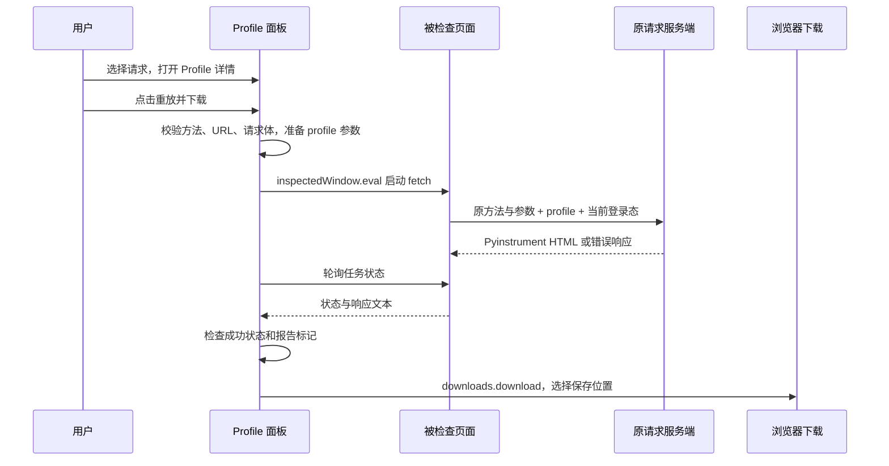

# 架构

Profile Downloader 没有扩展后台服务、业务服务器或前端框架。DevTools 为每个被检查页面创建独立的 Profile 面板；重放在该页面上下文执行。

## 文件职责

| 文件 | 职责 |
| --- | --- |
| `manifest.json` | Manifest V3 扩展入口、版本和 `downloads` 权限 |
| `devtools.html` / `devtools.js` | 创建 Profile DevTools 面板 |
| `panel.html` / `panel.css` | 紧凑请求表格、详情页签、主题与交互样式 |
| `panel.mjs` | DevTools 事件、录制/同步、选择、详情、右键菜单、重放和下载编排 |
| `network.mjs` | 请求记录展示、筛选、排序和 Network 风格数据转换 |
| `core.mjs` | 重放参数准备、请求执行、报告识别、下载文件名 |
| `tests.mjs` 与测试文件 | 纯函数及合成请求的验证；不依赖真实业务环境 |
| `scripts/` | 本地检查、敏感材料检查和发布打包 |

## 请求记录

`devtools.network.getHAR` 导入已记录的请求，`onRequestFinished` 接收新完成的请求。列表记录保存在面板内存中，去重并限制为 300 条；自身带 `profile` 的请求不进入列表。页面导航时按“保留日志”状态清理或保留记录。请求详情来自 HAR；响应正文仅在打开 Response 页签后按需读取。

这是一份 DevTools 网络记录的视图，不是全浏览器后台抓包。原始 Network 当前选中哪一行不会传递到扩展，扩展不能给原生行菜单注入动作。

## 重放与下载

`prepare` 只接受 GET / POST 和 HTTP(S)，保留其他查询参数的原编码并添加 `profile=1`，过滤浏览器不允许手动设置的请求头，保留其他头与完整 UTF-8 文本 body，拒绝不完整、非文本、非 UTF-8 或 multipart 请求。`startReplay` 创建独立 `AbortController`，通过 `fetch` 发送一次，设置超时并禁止重定向。面板轮询这一任务，完成后检查成功状态与预期 Pyinstrument HTML 结构、构造本地 Blob 并调用浏览器下载 API。

重放不会执行原页面的按钮、表单逻辑或重新生成令牌，因此它不保证与最初请求完全等价。页面 Service Worker、当前 Cookie、跨域策略及服务端状态都可能影响结果。取消和导航不能保证服务器回滚。

## 维护边界

保持展示代码与重放纯函数清晰分离。请求详情用文本节点渲染；不把请求字段或服务端响应拼进 `innerHTML`，也不在面板内执行报告。若增加权限、持久化、后台执行或新的 HTTP 方法，必须同步评估数据流、测试和用户文档，并按 [发布流程](releasing.md) 发布版本。
